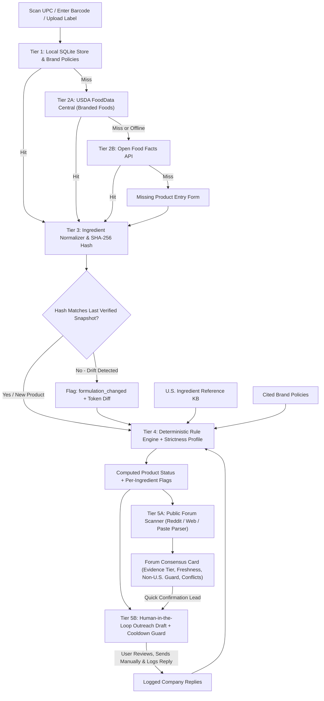
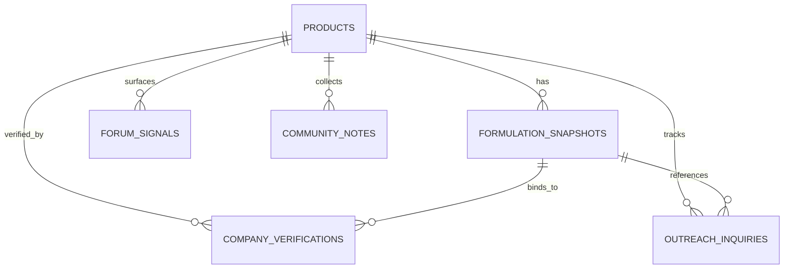

# HalalLens Technical Architecture & Verification Pipeline

HalalLens is a U.S. grocery barcode and ingredient-verification prototype designed around one core constraint: **public grocery barcode databases tell you what is printed on the label, not whether ambiguous ingredients are microbial/plant-derived or animal-derived**.

To solve this reliably without unthrottled automated mass-emailing to brands, HalalLens separates **Product Identification** from **Ingredient Source Verification** across a deterministic 5-tier pipeline.

---

## 1. Five-Tier Search & Verification Waterfall

### Tier Breakdown

| Tier | Component | Purpose | Trust Role |
| :--- | :--- | :--- | :--- |
| **Tier 1** | Local SQLite DB + `brand_policies` | Instant lookup of previously verified U.S. UPCs, snapshots, verifications, and brand-wide FAQ policies (e.g., Cabot microbial rennet policy). | Primary source of truth |
| **Tier 2** | `barcode_lookup.py` (USDA FDC -> Open Food Facts) | External fallback when a UPC isn't yet in local SQLite. Normalizes 12-digit UPC-A / 13-digit EAN-13 / 14-digit GTIN-14 variants. | Label discovery only (never verifies ambiguous sources by itself) |
| **Tier 3** | `ingredient_parser.py` + Browser `tesseract.js` OCR | Extracts ingredients from physical packaging photos or pasted text, parses nested parentheticals (e.g., `CHEDDAR CHEESE (MILK, CHEESE CULTURE, SALT, ENZYMES)`), and computes a SHA-256 `ingredient_hash` to detect silent reformulations. | Ground truth for what is on the physical package |
| **Tier 4** | `status_engine.py` | Evaluates matched rules, certifications, vegan flags, kosher context, personal strictness profile, brand policies, and dated company replies via strict precedence rules. | Deterministic verdict computation |
| **Tier 5A** | `forum_scanner.py` | Scans targeted subreddits (`r/halal`, `r/MuslimLounge`, `r/vegetarian`, `r/Costco`, `r/traderjoes`), pluggable web search adapters, or user-pasted forum threads. Extracts matched ingredients, claimed determination, evidence tier, freshness, and non-U.S. region warnings. | Decision support & verification leads (never auto-flips to green alone) |
| **Tier 5B** | `outreach.py` | Generates concise, per-ingredient email drafts (full inquiry or quick confirmation citing a forum lead), enforces product (30d) and brand (14d) cooldown warnings, provides `mailto:` + copy-to-clipboard, and logs company replies back to the exact `FormulationSnapshot`. | Human-in-the-loop primary verification |

---

## 2. Data Model (SQLite)

### Core Tables (`backend/app/db.py`)
- **`products`**: Canonical U.S. item metadata (`upc`, `name`, `brand`, `category`, halal certifier info, `kosher_symbol`, `is_certified_vegan`, brand contact email/URL, cached `computed_status`).
- **`formulation_snapshots`**: Immutable label snapshots (`raw_ingredients`, `normalized_ingredients`, `ingredient_hash`, `source_type`, optional `lot_code` and `plant_code`, `captured_at`, `is_current`). Never overwrites historical snapshots when a label changes.
- **`ingredient_rules`**: U.S.-tailored reference knowledge base (`canonical_name`, `aliases_json`, `default_risk`, `us_context_notes`, `verification_question`, `kosher_vegan_caveat`, `strictness_key`).
- **`brand_policies`**: Cited manufacturer-wide statements (`brand`, `scope_description`, `applies_to_ingredients_json`, `determination`, `source_url`, `excerpt`, `checked_date`, `expires_at`).
- **`company_verifications`**: Dated manufacturer responses tied to a specific `formulation_snapshot_id` and `ingredient_name` (`determination`, `varies_by_supplier`, `contact_channel`, `company_contact`, `response_excerpt`, `lot_code`, `plant_code`, `verified_date`, `expires_at`).
- **`outreach_inquiries`**: Human-in-the-loop drafts & tracking (`mode`, `state`: `drafted` -> `sent_by_user` -> `reply_logged` -> `closed`).
- **`forum_signals`**: Structured public forum intelligence (`source_platform`, `source_name`, `url`, `title`, `author`, `posted_at`, `raw_excerpt`, `matched_ingredients_json`, `claimed_determination`, `evidence_tier`, `region_flag`, `region_notes`).
- **`community_notes`**: Personal / crowd-sourced aisle observations labeled as secondary context.
- **`user_settings`**: Singleton storing the user's **Personal Strictness Profile**.

---

## 3. Deterministic Status Precedence

Status is recalculated deterministically for the **current** `FormulationSnapshot`:

1. **`animal_or_haram`** (Highest Priority)
   - Triggered if any ingredient matches a `haram_animal` rule (e.g., `pork gelatin`, `porcine gelatin`, `lard`, `carmine`, `cochineal`, `wine`) OR an active company verification confirms `animal_or_haram`.
2. **`formulation_changed`**
   - Triggered if the current snapshot's `ingredient_hash` differs from the snapshot linked to the most recent active `company_verification` on the product. Computes exact `+ Added` and `- Removed` token diffs and forces re-verification.
3. **`certified_halal`**
   - Triggered if a valid active halal certification (e.g., `IFANCA`, `HFSAA`, `ISWA`, `ISA`, `HMS`) applies to the current snapshot.
4. **`mushbooh_needs_check`**
   - Triggered if any flagged `mushbooh` ingredient (under the active Strictness Profile) is unresolved, has an expired verification, OR has a manufacturer confirmation with `varies_by_supplier = true`.
5. **`verified_plant_or_microbial`**
   - Awarded only when zero haram triggers exist, no reformulation drift is active, `varies_by_supplier = false`, and every flagged mushbooh ingredient is resolved by one of:
     - Explicit label qualifier (e.g., `"microbial enzymes"`, `"vegetable mono- and diglycerides"`, `"plant-based glycerin"`),
     - Active, non-expired `company_verification` (`plant_or_microbial` or `synthetic`) matching the current snapshot,
     - Active, non-expired matching `brand_policy`,
     - `is_certified_vegan = true` (resolves animal-derived risks, never overrides alcohol/ethanol flags),
     - User-enabled kosher strictness preference (`treat_oud_enzymes_as_verified = true` for recognized U.S. agencies `OU-D`, `OU-Pareve`, `OK`, `Star-K`, `Kof-K` — explicitly excludes generic uncertified `"K"`).

---

## 4. Edge-Case Safeguards

- **Silent Manufacturer Reformulations**: Hashing normalized ingredients detects subtle changes (such as adding `mono- and diglycerides` or `natural flavors` without changing the UPC). Historical verifications remain pinned to the older snapshot ID while the product immediately enters the **Review Queue** under `formulation_changed`.
- **Supplier & Plant Variability**: If customer support replies *"sourcing depends on plant availability and can be plant or animal"*, setting `varies_by_supplier = true` prevents a false green verdict and displays a prominent supplier-variability warning.
- **Non-U.S. Forum Trap**: Many multinational brands (Haribo, Kraft, Doritos, KitKat) use different gelatin or enzyme sources in Canada, the UK, Turkey, or the EU compared to the U.S. The forum parser detects non-U.S. regional cues (`UK`, `Canada`, `Tesco`, `Turkey`, `EU`, etc.), tags those signals `non_us_warning`, excludes them from U.S. consensus conflict logic, and warns the user explicitly.
- **Verification Staleness**: Company verifications and brand policies carry an `expires_at` date (default 12 months) and surface automatically in `/api/review-queue` when expiring within 30 days or past due.
- **Brand Contact Cooldown**: Before drafting an outreach email, `outreach.py` inspects `outreach_inquiries` for recent contacts to the same product (30 days) or brand (14 days) and raises an inline cooldown warning to prevent spamming customer support teams.

---

## 5. Production Scaling Path

This prototype runs locally with zero infrastructure dependencies (FastAPI + SQLite + Vite/React). To evolve into a multi-user mobile app:
1. Swap SQLite (`db.py`) for **PostgreSQL** with Alembic migrations and pg_trgm full-text search.
2. Wrap the responsive web UI in **Capacitor** or build a **React Native / Expo** client with native camera barcode scanning (`VisionCamera` / `MLKit`) and on-device OCR.
3. Add a background worker queue (Celery / Dramatiq) to periodically re-check USDA FDC snapshots and brand FAQ URLs for drift, plus optional LLM summarization behind the `forum_scanner.py` parser interface for long multi-comment Reddit threads.
4. Configure `USDA_API_KEY` (free from `fdc.nal.usda.gov`) and an optional `WEB_SEARCH_API_KEY` (Brave Search) for expanded live Tier 2 and Tier 5A coverage.
